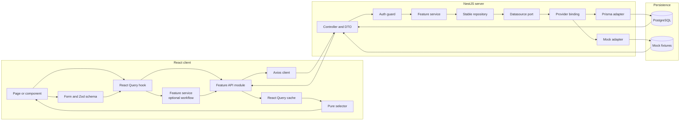

# Application Wiring

This diagram shows how a client component is wired through the frontend and backend layers to persistence. It describes implementation boundaries, not product requirements or visual design.

## Boundary rules

- Components do not call Axios or implement persistence workflows.
- Hooks own React Query state and cache invalidation.
- API modules own HTTP communication only.
- Server services do not know whether the adapter is Prisma or mock.
- Provider selection happens in module dependency injection.
- Stable repositories depend on datasource ports, not concrete adapters.
- Prisma is the persistence source of truth for database-backed modes.